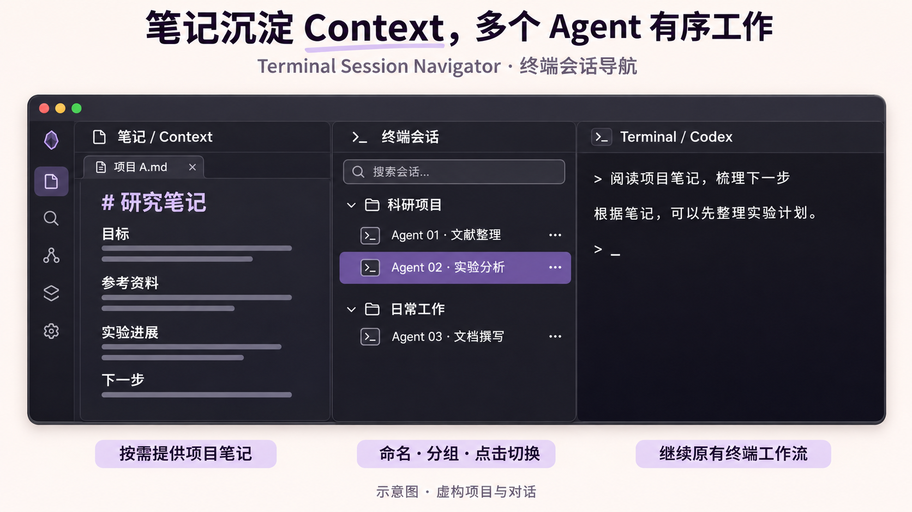

# AI 时代，用 Obsidian 作为你的科研和工作中台吧！

让论文、实验记录和项目进展沉淀成 Markdown，按需交给 Agent 作为 **Context**。多个任务同时推进，也能在同一个工作台里找到各自的对话。

**Terminal Session Navigator · 终端会话导航**，为 Obsidian 的 Terminal 插件增加一个轻量会话列表，继续使用你熟悉的终端和 Codex CLI。



- **每个任务有名字**：给论文修改、实验分析、项目开发的终端分别命名。
- **按项目收拢对话**：多个 Agent 的终端会话分组排列，支持折叠和搜索。
- **点击继续工作**：直接切换到原终端，名称自动换行，列表宽度可调整。

## 安装

需要**桌面版 Obsidian**；终端里的 Codex 等 Agent 请自行配置。目前通过 GitHub 分发。

### 方式一：手动安装

1. 在 Obsidian「设置 → 第三方插件 → 浏览」中找到并安装 **[Terminal](https://github.com/polyipseity/obsidian-terminal)**（作者 **polyipseity**），启用后确认能打开集成终端。
2. [下载 0.1.1 安装包](https://github.com/nosignalmxh/obsidian-terminal-session-navigator/releases/download/0.1.1/terminal-session-navigator-0.1.1.zip)，解压得到 `terminal-session-navigator` 文件夹。
3. 把文件夹放到你的 vault 中：`.obsidian/plugins/terminal-session-navigator/`，该目录内应直接包含 `main.js`、`manifest.json`、`styles.css`。macOS 可按 `⌘⇧.` 显示隐藏文件夹；若使用自定义配置目录，请用它替换 `.obsidian`。
4. 在「设置 → 第三方插件」中启用 **终端会话导航**，再从命令面板运行 **打开终端会话列表**。

终端在右侧栏时，列表默认位于 Markdown 与终端之间，也可以拖动调整。升级时保留已有的 `data.json`，其中保存了名称和分组。

### 方式二：让 Agent 安装

把下面的 vault 路径替换成自己的路径，交给能操作本机文件的 Agent：

```text
请直接帮我安装 Obsidian 插件“终端会话导航”。
仓库：https://github.com/nosignalmxh/obsidian-terminal-session-navigator
目标 vault：<填写你的 vault 路径>

1. 确认目标 vault 及配置目录（默认 .obsidian）。检查 Terminal
   （polyipseity，插件 ID：terminal）是否可用；缺少时按其官方说明安装：
   https://github.com/polyipseity/obsidian-terminal
2. 从导航插件仓库的最新正式 Release 下载 main.js、manifest.json、
   styles.css，放入 <配置目录>/plugins/terminal-session-navigator/。
   核对 manifest 的插件 ID 和版本，升级时保留已有 data.json。
3. 通过可用的 Obsidian CLI 或界面启用导航插件；若无法直接操作，
   告诉我需要在哪里点击。完成后报告安装路径、版本和实际启用状态。

请保留原 Terminal 配置、已有会话和笔记；不要重启 Obsidian 或 Terminal，
也不要向正在运行的终端发送命令。
```

## 开始使用

**单击切换 · 双击命名 · 条目右侧 ⋯ 移入分组 · 顶部搜索**。名称和分组保存在本机，终端进程与对话恢复仍由 Terminal 和 Codex 管理。

已验证：macOS、Obsidian **1.14.5**、Terminal **3.23.0**；其他系统和旧版尚未实测。详见 [验证记录](VALIDATION.md)。

[MIT 许可证](LICENSE) · [所有版本](https://github.com/nosignalmxh/obsidian-terminal-session-navigator/releases) · [维护与发布](PUBLISHING.md)
